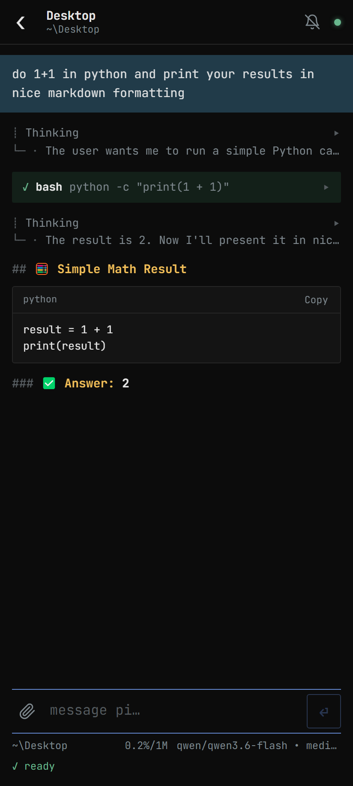
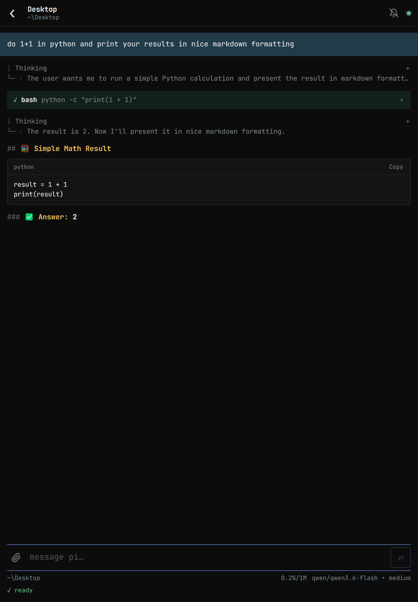
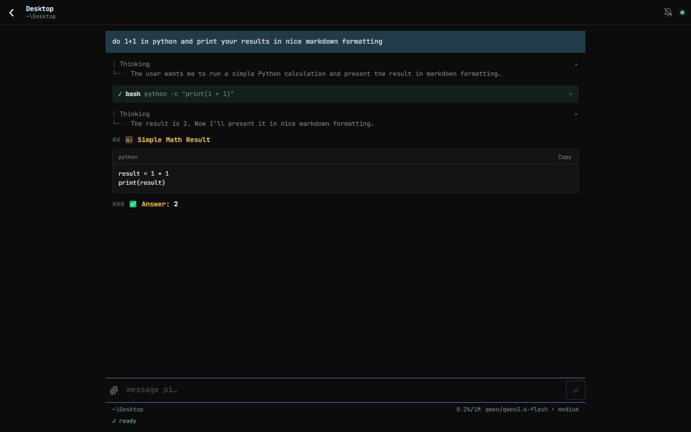

<p align="center">
  
</p>

<h1 align="center">Pi Mobile</h1>

Pi Mobile lets you follow and drive your [pi](https://pi.dev) sessions from an Android
phone on the same network as your PC. You can see which sessions are open, read the
transcript as it updates, send prompts and slash commands, attach images or files, and
get a notification when a turn finishes.

It runs on your local network. There is no account and no server of ours in between.
The one exception is notifications, which you turn on per session with `/notify`.
They go through your browser's push service (see [Notifications](#notifications)).

<table>
  <tr>
    <th>Phone</th>
    <th>Tablet</th>
  </tr>
  <tr>
    <td width="34%"></td>
    <td></td>
  </tr>
  <tr>
    <th colspan="2">Desktop browser</th>
  </tr>
  <tr>
    <td colspan="2"></td>
  </tr>
</table>

## Using it away from home

Pi Mobile has no relay server. The phone connects straight to your PC, so it only works
when the phone can reach the PC's IP address directly, such as on the same Wi-Fi.

To use it from elsewhere, put both devices on a private virtual network such as
[Tailscale](https://tailscale.com) (ZeroTier and WireGuard work too). When you run
`/mobileauth`, pick the PC's address on that network (for Tailscale, the one starting
with `100.`) and pair as usual. The certificate covers every address the PC has,
including the virtual one, but the broker only reads the addresses when it starts. If
you connect to the virtual network after the broker is running, restart it with
`npm run broker:stop` and then open a pi session.

Don't forward the broker's ports on your router to expose it to the internet.

> **Disclaimer:** Pi Mobile is an independent, third-party extension for pi. It is not
> affiliated with, endorsed by, or supported by the pi project or its authors. "pi" is
> used here only to describe what this extension works with.

## Features

- A live list of every pi session running on your PC, with its folder, model, thinking
  level and context usage.
- The transcript of each session, updated as each message or tool call completes.
  Markdown, code blocks and tables are rendered, and tool calls are shown with their
  output.
- Prompts typed on the phone are sent into the running pi session. They appear in the
  terminal as normal messages, marked "via mobile". While pi is working you can choose
  to steer the current turn or queue the prompt for afterwards, or stop the turn.
- Attachments. Images are sent to the model directly (this needs a model that accepts
  images). Other files, up to 50 MB, are saved on the PC and their path is added to the
  prompt so the agent can open them.
- Slash commands from the phone: `/compact`, `/model`, `/thinking`, `/name`,
  `/session`, `/new` and `/reload`, plus any commands, skills or prompt templates your
  extensions provide. Commands that open a picker in the terminal, such as `/settings`
  or `/resume`, are not available. To send a prompt that starts with a slash, begin it
  with `//`.
- A notification when a full turn finishes, not after every tool call, even when the
  app is closed. Turn it on per session with `/notify`. A bell marks those sessions in
  the app.

## Requirements

- pi, installed and working on your PC
- Node.js 18 or newer
- An Android phone with Chrome, on the same network as the PC

iPhone may work but has not been tested.

## Installation

Clone or download this folder somewhere permanent, then:

```bash
npm install
npm run install-extension
```

`install-extension` adds one line to `~/.pi/agent/settings.json` so the extension loads in
every pi session. A backup of the file is saved next to it. Nothing else is installed
outside this folder.

Restart any pi sessions that are already open.

## Pairing a phone

Pairing only needs to be done once per phone.

1. In any pi session, run `/mobileauth`. A QR code appears in the terminal.
2. Scan it with the phone's camera. A setup page opens in the browser.
3. Tap **download certificate**. Then open Android **Settings**, search for
   **CA certificate**, tap **Install anyway** and choose `pi-mobile-ca.crt`. Go back to the
   setup page; it detects the certificate automatically.
4. Check that the fingerprint on the page matches the one under the QR code in pi.
5. Tap **open pi mobile**. Pairing completes and the session list appears.
6. Allow notifications when asked, and use Chrome's menu to add Pi Mobile to your
   home screen.

The certificate is generated on your PC. Installing it lets the phone trust the
encrypted connection to the PC. Codes expire after five minutes and can only be used
once. Run `/mobileauth` again for a new one, or to pair another phone.

## Commands in pi

| Command | Description |
|---|---|
| `/mobileauth` | Show a QR code to pair a phone |
| `/mobilestatus` | List paired phones and revoke one or all of them |
| `/mobileqr` | Hide the pairing QR code if it was shown as a widget |
| `/notify [on\|off]` | Push this session's turn completions even when the app is closed. Toggles without an argument. |

## How it works

```
 pi session        pi session             the extension runs inside each pi process
     \                 /
      \               /       local socket (127.0.0.1 only, shared secret)
       \             /
        +-----------+
        |  broker   |         one background process for all sessions
        +-----------+
              |               HTTPS and secure WebSocket over your LAN
        +-----------+
        |  web app  |         installable app on the phone
        +-----------+
```

- `extension/index.ts` runs inside pi. It registers the session, forwards messages and
  status to the broker, and delivers prompts and commands from the phone.
- `broker/broker.mjs` is a small Node server. The first pi session starts it, and it keeps
  running after individual sessions close. It serves the web app, holds the session
  list and relays messages in both directions.
- `pwa/` is the phone app. It is a plain web app with no build step.

The message format is described in `docs/PROTOCOL.md`.

## Security

Traffic between the phone and the PC is encrypted with TLS. Each paired phone has its
own random token, which the broker stores only as a hash. The connection between pi and
the broker only accepts local connections that know a secret stored in `state/`.

Some points to be aware of:

- A paired phone can send prompts to your agent, which can run commands on your PC.
  Treat the phone as having that level of access, and revoke it with `/mobilestatus` if
  it is lost.
- The `state/` folder holds the certificate authority's private key. Anyone who copies
  that key could create certificates your phone would trust. Keep the folder private and
  do not commit or share it. It is excluded from git by default.
- The setup page opened by the QR code uses plain HTTP, because the phone does not trust
  the PC yet at that point. Comparing the fingerprint during pairing protects against
  someone on the network swapping the certificate.

## Notifications

Notifications are off until you turn them on for a session with `/notify`, in pi or
from the phone. The footer in pi then shows "🔔 push" and the app shows a bell next to
the session. Run `/notify off` to stop. The setting is kept for the session across
restarts, in `state/notify.json`.

When such a session finishes a turn, the broker sends a Web Push to every phone that
isn't using the app at that moment, whether it is in the background, closed or in split
screen behind another app. On Android that goes through Google's push service
(Firebase Cloud Messaging), which wakes the phone and delivers it. If you are using the
app, it shows a banner at the top instead.

The app no longer shows notifications itself over the local connection, because Chrome
freezes it a few minutes after it goes to the background and the connection stops
with it.

- The PC needs internet access for this. Everything else still stays on your network.
- No account or Firebase project is needed. The broker creates its own signing key in
  `state/vapid.json`.
- The notification text (the session name and the first 140 characters of the agent's
  last reply) is encrypted on the PC with a key that only Chrome on your phone holds.
  Google's push service relays it but can't read it. It does see when each
  notification is sent, roughly how long it is, and your PC's public IP address.
- A notification that can't be delivered right away waits up to six hours, and only
  the latest one per session is kept.

To stay fully local, with no notifications at all, add `"webPush": false` to
`state/config.json` and restart the broker.

## Managing the broker

The broker starts on its own. To control it manually:

```bash
npm run status        # show the process id, address and ports
npm run broker        # run it in the foreground
npm run broker:stop   # stop it
```

After updating Pi Mobile, stop the broker and restart your pi sessions so both pick up
the new code. On the phone, close the app fully and open it again.

## Uninstalling

```bash
npm run uninstall-extension
npm run broker:stop
```

Then delete this folder. Paired phones, certificates and uploaded files are all kept in
`state/`. You can also remove the certificate from the phone under Settings, by
searching for "user credentials".

## Troubleshooting

**The phone can't reach the PC.** Check that both are on the same Wi-Fi. If pi asks which
network adapter to use, pick the one with your Wi-Fi address, usually `192.168.x.x`.
Windows may ask whether to allow Node.js through the firewall; allow it on private
networks. If it was blocked, add inbound rules for TCP ports 47080 and 47443.

**The app says the connection isn't private.** The certificate isn't installed, or was
installed as a VPN or Wi-Fi certificate instead of a CA certificate. Repeat step 3 of
pairing.

**No sessions are listed.** Only pi sessions that are running with the extension loaded
appear. Start pi in a terminal and the session should show up within a couple of
seconds.

**Images are ignored by the model.** The current model doesn't accept images, and pi
replaces them with a placeholder. The app warns about this before sending. Switch to a
model that supports images with `/model`.

**Notifications arrive but don't pop up on screen.** Android decides this per app.
Long-press a Pi Mobile notification, tap the settings icon and turn on "Pop on screen"
("Pop-up" style on Samsung).

**The app doesn't rotate.** If Pi Mobile was added to the home screen before landscape
support, remove it and add it again from Chrome.

**No notifications.** Run `/notify` in the session first; notifications are off by
default. If it shows the bell, check that the PC has internet access and that
notifications are allowed for Pi Mobile. Open the app once after updating, so it can
register for push. The broker logs a line when a push fails; run `npm run broker` in a
terminal to see it.

**The default ports are in use.** Create `state/config.json` with your own values:

```json
{ "httpsPort": 47443, "httpPort": 47080, "loopbackPort": 47799 }
```

Then restart the broker and pair the phone again.

## License

MIT. See [LICENSE](LICENSE).
